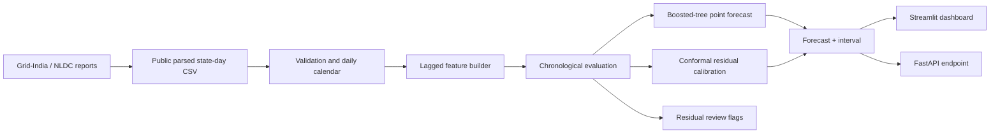

# Bijli ⚡

**Probabilistic electricity energy-met forecasting for Indian states, with residual anomaly review.**

A reproducible portfolio project built from the public Grid-India / NLDC daily state power supply position dataset. It demonstrates a complete path from source data to time-aware evaluation, uncertainty intervals, a Streamlit dashboard, a small JSON API, and scheduled data refresh.

> The target is reported **energy met (MU/day)**. Energy met is the amount of energy served/reported and is only a proxy for demand: when supply is constrained, it may differ from unconstrained demand. This demo is for research and learning, not operational grid dispatch.

## What is included

- A bundled public state-day snapshot (2022 onward) so the dashboard opens without a download.
- A checked data loader and calendar-aligned lag and rolling features.
- A 7-day seasonal-naive baseline and scikit-learn histogram gradient boosting model.
- A chronological holdout and split-conformal prediction bands; no random train/test split.
- Recursive 1–14 day forecast so the model never reads future actual targets.
- Robust residual flags for human review, a Streamlit app, and FastAPI endpoint.
- Optional Open-Meteo historical weather fetch helper for exploratory analysis. It is not used for future predictions because observed archive weather would leak future information.
- Dockerfile and weekly GitHub Actions workflow to refresh the source snapshot.

## Quick start

Python 3.10–3.12 is recommended (scikit-learn wheels may lag the newest Python release).

```bash
python -m venv .venv
# Windows: .venv\Scripts\activate
# macOS/Linux: source .venv/bin/activate
python -m pip install -r requirements.txt
streamlit run app.py
```

CLI forecast:

```bash
python scripts/train.py --state Maharashtra --horizon 7
```

Optional API:

```bash
uvicorn api:app --reload
# GET http://127.0.0.1:8000/forecast?state=Maharashtra&horizon=7
```

Refresh the bundled data:

```bash
python scripts/fetch_data.py
```

## Method

For each reported state/entity, the target is daily energy met in million units. Features include day of week, month, annual sine/cosine seasonality, lags (1/7/14/28 days), and rolling mean/standard deviation computed strictly from prior days. Missing dates are kept missing on a daily calendar rather than silently compressing time.

The evaluation reserves a recent chronological block, uses an earlier part for point-score reporting and a later calibration segment to set a symmetric absolute-residual interval. The reported coverage is measured on that calibration segment and is not a guarantee of future coverage. Split conformal relies on calibration examples being representative; electricity demand drifts, so monitor calibration as new data arrives. The dashboard compares point scores with a 7-day seasonal-naive baseline. Metrics are computed on one chronological holdout, not repeated rolling-origin validation.

Anomaly flags mark unusually large residuals in the calibration window using median plus 4.5 scaled MAD. A flag identifies a day worth investigating; it does not identify the cause (weather, outage, holiday, reporting error, or otherwise).

## Data source and attribution

Bundled snapshot: [`study3_states.csv`](https://github.com/HalcyonVector/Grid-Sentinel/blob/main/Dataset/study3_states.csv), redistributed as `data/raw/state_daily.csv` from [Halcyon Vector, India Power Grid — NLDC Daily PSP Reports](https://github.com/HalcyonVector/Grid-Sentinel/tree/main/Dataset). The source describes state/date records and columns such as `energy_met_mu`, and is published under **CC BY-SA 4.0**. Source data is compiled from [Grid-India / NLDC](https://grid-india.in/). The bundled file retains original values and columns and includes records from 2022 onward. Refreshing uses the latest upstream file; verify upstream schema/license before redistributing future versions.

Historical weather helper uses the [Open-Meteo Historical Weather API](https://open-meteo.com/en/docs/historical-weather-api), with representative cities for a subset of states. Those city-level readings are approximate context, not state-average weather.

## Architecture



## Results and limitations

Run `python scripts/train.py --state Maharashtra` to produce current state-specific holdout metrics and a forecast. Scores are computed at run time because source refreshes change evaluation dates. Do not claim a percentage improvement until measured against the same untouched chronological dates and documented in a run artifact.

- Reported daily energy met is not peak MW demand; distinguish units and target in any presentation.
- This baseline has one holdout, no repeated rolling-origin CV, and no external weather forecast or official holiday feed in the model.
- Festival dates in `src/bijli/calendar.py` are illustrative and not connected to the feature set. Verify them against authoritative calendars before operational use.
- Calibration is marginal and may under-cover during regime shifts or exceptional events.
- Some reported entities are grid drawal entities as well as states; choose a genuine state for state-level interpretation.
- Next steps: walk-forward backtests, weather forecast vintages, verified state holiday calendars, model persistence, and monitoring.

## Repository layout

```text
app.py                         Streamlit dashboard
api.py                         FastAPI forecast endpoint
src/bijli/forecast.py          Features, model, evaluation, intervals, flags
src/bijli/weather.py           Optional historical weather helper
src/bijli/calendar.py          Illustrative festival calendar helper
scripts/fetch_data.py         Refresh source snapshot
scripts/train.py              CLI train/evaluate/forecast
data/raw/state_daily.csv      Attributed public snapshot
.github/workflows/            Weekly source refresh workflow
```

## License

Project code: MIT (`LICENSE`). Data: CC BY-SA 4.0 as stated upstream; data terms continue to apply to the bundled snapshot and derivatives.
